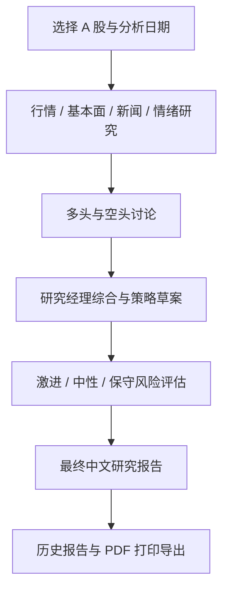

# 观澜 MarketPrism

**从多个视角看清市场，让股票研究有据可循。**

面向中国 A 股的 AI 股票研究工作台，结合多智能体分析、中文研究报告、Tauri 桌面体验和可自托管的服务端。适合个人研究、投研流程实验，以及希望自行管理模型与数据的开发者。

[English](README.en.md) · [部署指南](docs/a-share-server-deployment.md) · [贡献指南](CONTRIBUTING.md) · [安全说明](SECURITY.md) · [更新记录](CHANGELOG.md)

> 当前为早期开发版本，主要定位于盘后研究。提供分析与报告，不连接券商，不执行真实交易，不承诺预测准确率或投资收益。

## 为什么做 MarketPrism

一份股票研究需要同时考虑行情、基本面、新闻与市场情绪。MarketPrism 将这些信息组织成可查看的分析流程：先由不同角色研究，再通过多空讨论和风险评估形成中文报告。用户可以查看研究过程与历史结果，开发者也可以替换模型、数据源或研究节点。

“观澜”取观察市场波澜之意；“Prism”是棱镜，代表从多个角度理解同一份市场信息。

## 核心能力与优势

| 能力 | 当前实现 | 使用价值 |
| --- | --- | --- |
| 多智能体研究 | 技术行情、基本面、新闻、情绪分析；多空研究员讨论；不同风险偏好角色评估 | 分阶段呈现不同观点，方便核对推理依据 |
| 中文 A 股体验 | A 股搜索、代码标准化、简体中文报告与评级展示 | 减少市场代码与语言切换成本 |
| 桌面工作台 | Tauri 2 + React + TypeScript，分析进度、阶段事件与报告视图 | 集中完成选股、研究、阅读和回看 |
| 多模型适配 | 国内模型预设、OpenAI-compatible 网关、Ollama 及其他供应商适配器 | 按预算、部署条件和能力要求配置模型 |
| 分层模型配置 | 快速研究模型和深度思考模型分别配置 | 为资料分析和综合判断选择不同模型 |
| 多源数据 | AkShare 默认来源，BaoStock、Tushare 可选，部分接口含备用路径 | 降低对单一公开接口的依赖；覆盖范围因接口而异 |
| 缓存与预热 | 服务端公开数据缓存、分析过的股票记忆、定期行情预缓存 | 减少重复请求，缓解公开接口临时中断 |
| 可自托管 | 授权、数据网关、分析任务和报告服务可自行部署 | 统一管理模型配置，普通客户端无需填写模型 Key |
| 报告留存 | 历史报告查看，调用打印面板导出 PDF | 便于复盘与归档；PDF 保存依赖系统打印能力 |
| 开发者可扩展 | Python / FastAPI / LangGraph，前后端分层，现有自动化测试 | 便于接入新数据、调整研究流程或构建衍生应用 |

多智能体讨论提供不同分析视角，但并不等于独立事实核验，也不保证结论更准确。

## 工作流程



分析阶段通过事件流呈现。任务耗时和模型费用取决于所选模型、数据可用性、研究深度与讨论轮数。

## 运行架构

```text
React / Tauri 桌面界面
          │ http://127.0.0.1:8765
          ▼
Python 本地桌面 API
          │ 登录、数据请求、分析事件与报告
          ▼
自托管 FastAPI 服务（默认本机端口 18080）
          ├── 账号授权与管理
          ├── A 股数据采集、缓存和预热
          ├── LangGraph 多智能体研究 → 配置的模型服务
          └── 报告保存
```

项目包含本地分析能力，也支持客户端与服务端分开部署。**默认桌面流程需要登录，默认启用服务端分析与数据网关**。可以把服务端和桌面端都运行在自己的电脑上；仓库不附带公共服务器、登录账号或模型额度。

“本地优先”描述桌面与可自托管的运行方式，并不代表所有计算离线：使用云模型时，相关研究输入会发送给配置的模型服务；行情来源也通常需要网络。

## 快速开始

### 1. 获取源码与依赖

需要 Python 3.10+（建议 3.12）、Node.js 20.19+ 或 22.12+。原生桌面开发还需要 Rust 工具链及 Tauri 的系统依赖；Windows 需要 C++ 构建工具与 WebView2。

```powershell
git clone https://github.com/yueshenmoyin/MarketPrism.git
cd MarketPrism
python -m venv .venv
.\.venv\Scripts\Activate.ps1
python -m pip install -e .
npm ci
```

macOS / Linux 的虚拟环境激活命令为 `source .venv/bin/activate`。当前仓库提供 Windows 安装包脚本；其他平台的原生打包尚需自行配置和验证。

### 2. 启动自己的分析服务

在已激活虚拟环境的 PowerShell 中设置环境变量。将示例地址、模型名、密码和 Key 换成自己的值；不要把实际值写进源代码或提交到 Git。

```powershell
$env:AITRADE_AUTH_USERNAME = "admin"
$env:AITRADE_AUTH_PASSWORD = "<设置一个强密码>"
$env:AITRADE_AUTH_USERS_FILE = "$HOME/.aitrade/auth_users.json"
$env:AITRADE_DATA_CACHE_DIR = "$HOME/.aitrade/server_data_cache"
$env:AITRADE_RESULTS_DIR = "$HOME/.aitrade/results"
$env:AITRADE_LLM_PROVIDER = "custom_openai_compatible"
$env:AITRADE_CUSTOM_BASE_URL = "https://your-gateway.example.com/v1"
$env:AITRADE_CUSTOM_API_KEY = "<你的模型 API Key>"
$env:AITRADE_QUICK_THINK_LLM = "<网关支持的快速模型名>"
$env:AITRADE_DEEP_THINK_LLM = "<网关支持的深度模型名>"
python -m aitrade.server.auth_api
```

健康检查：`http://127.0.0.1:18080/health`。账号管理入口：`http://127.0.0.1:18080/admin`，使用上面的管理员账号登录，可创建、停用账号及设置有效期。

`.env.example` 是配置参考。有 python-dotenv 时，Python 包导入会从当前目录向上查找并加载 `.env` / `.env.enterprise`，已设置的进程环境变量优先。生产环境建议通过服务管理器显式注入变量，避免误读其他目录的配置。

### 3. 启动桌面界面

新开一个 PowerShell，进入项目、激活同一虚拟环境：

```powershell
.\.venv\Scripts\Activate.ps1
$env:AITRADE_AUTH_SERVER_URL = "http://127.0.0.1:18080"
npm run tauri -- dev
```

登录后搜索股票、选择研究日期和深度、发起分析，然后查看研究过程与报告。

只调试浏览器界面时，可分别运行 `npm run desktop:api` 和 `npm run dev`，访问 `http://localhost:1420`。运行本地 API 的终端同样需要设置 `AITRADE_AUTH_SERVER_URL`。

已有桌面配置会被读取。如果修改环境变量后仍连接旧服务，请检查 `~/.aitrade/desktop_config.json`；可用 `AITRADE_DESKTOP_CONFIG` 指定独立配置文件。该文件可能包含令牌或密钥，不应分享。

## 配置说明

为兼容已有配置，Python 包名 `aitrade`、`AITRADE_*` 环境变量、`.aitrade` 数据目录与内部程序标识继续保留；对外产品名统一为 **观澜 MarketPrism**。

| 配置 | 作用 |
| --- | --- |
| `AITRADE_AUTH_SERVER_URL` | 桌面端连接的服务端地址 |
| `AITRADE_LLM_PROVIDER` | 模型供应商，如 `custom_openai_compatible`、`ollama` |
| `AITRADE_CUSTOM_BASE_URL` / `AITRADE_CUSTOM_API_KEY` | 自定义模型网关和密钥 |
| `AITRADE_QUICK_THINK_LLM` / `AITRADE_DEEP_THINK_LLM` | 两级研究模型名称 |
| `AITRADE_ADVANCED_MODE` | 默认 `false`；开发者可设为 `true` 显示高级设置 |
| `AITRADE_SERVER_ANALYSIS_ENABLED` | 默认 `true`，由服务端运行研究任务 |
| `AITRADE_DATA_GATEWAY_ENABLED` | 默认 `true`，通过服务端获取数据 |
| `TUSHARE_TOKEN` | 选择 Tushare 时需要的个人令牌 |
| `AITRADE_PRECACHE_ENABLED` | 开启服务端后台行情预缓存 |

本地分析实验可关闭服务端分析和数据网关，并在本地配置模型；这不会取消桌面端的登录流程。使用 Ollama 也需要适合工具调用与研究任务的本地模型，效果和速度取决于模型及硬件。

详细部署、缓存参数及故障排查见 [服务端部署指南](docs/a-share-server-deployment.md)。

## 开发与验证

```powershell
python -m pip install pytest httpx
python -m pytest tests -q
npm run test:frontend
npm run build
cargo test --manifest-path src-tauri/Cargo.toml
```

### Windows 安装包

```powershell
npm run package:windows
# 包含检查的构建
npm run package:windows -- -RunChecks
```

产物目录：`src-tauri/target/release/bundle/`。脚本会准备 Python 后端并构建 NSIS 安装包。打包应使用不含私人凭据的环境，安装包和本地构建产物不纳入源码仓库。

## 项目结构

```text
src/                    React 桌面界面与前端测试
src-tauri/              Rust 桌面壳、后端生命周期与安装配置
aitrade/agents/         分析师、研究员、风险评估及管理节点
aitrade/graph/          LangGraph 工作流与状态管理
aitrade/dataflows/      行情、新闻、基本面等数据接口
aitrade/llm_clients/    模型供应商适配
aitrade/desktop/        本地桌面 API
aitrade/server/         授权、数据网关、缓存与分析任务
cli/                    命令行入口
tests/                  Python 回归测试
scripts/                打包与辅助脚本
docs/                   部署说明与设计文档
```

## 当前边界

- 主要支持 A 股研究流程；保留的其他市场适配代码不代表桌面端已完整支持那些市场。
- 公开行情可能延迟、缺失、限流或临时不可用；缓存数据也可能过时，不适合作为实时交易报价。
- 模型会产生错误和无依据的结论；使用者应核对原始数据、公告和报告中的关键事实。
- 当前任务管理采用进程内状态，服务重启可能中断运行中的任务；不是分布式任务平台。
- 自托管服务需要自行配置 HTTPS、访问控制、备份与资源限制；不要将本地桌面 API 直接暴露到公网。
- 模型调用、付费数据源和服务器的费用由使用者承担。

## 参与贡献

欢迎通过 Issues 报告可复现问题、提出数据源兼容需求或讨论研究流程改进。提交 PR 前请阅读 [贡献指南](CONTRIBUTING.md)。提交日志与截图时请先删除 API Key、令牌、账号密码和私人服务信息。

## 许可与致谢

本仓库保留 [Apache License 2.0](LICENSE)。研究工作流源自 TradingAgents 项目，在此基础上开展 A 股数据适配、中文桌面交互、自托管服务和报告功能等改造；详见 [来源说明](NOTICE)。感谢上游项目以及 LangGraph、AkShare、BaoStock、Tushare、FastAPI、Tauri 和 React 等开源生态。

项目仅用于研究、学习与软件开发，不构成投资建议。请独立判断并自行承担投资决策风险。
